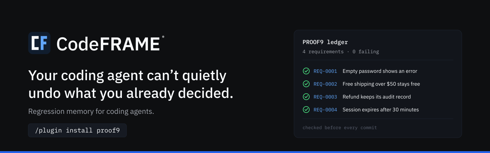
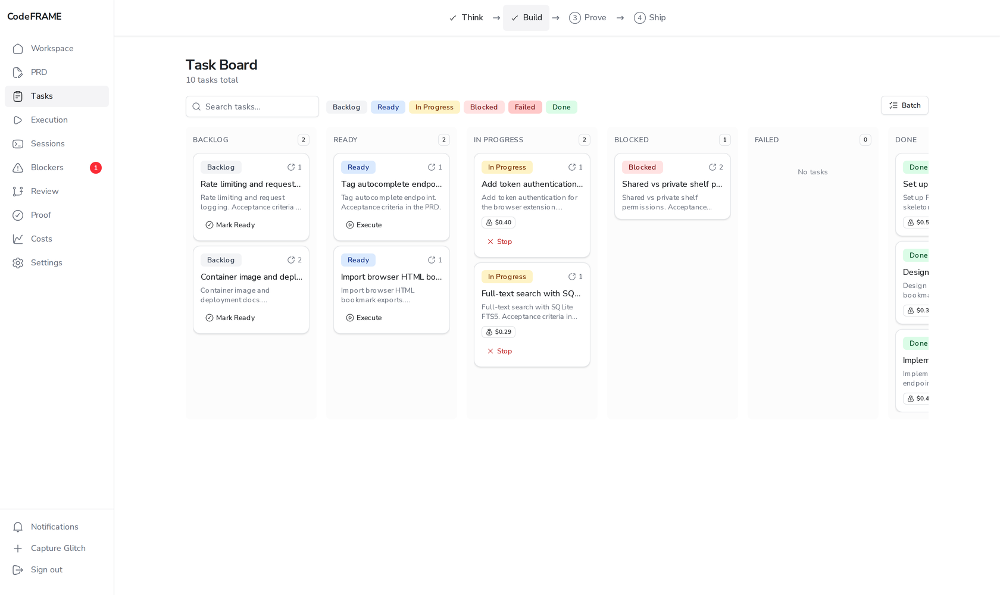
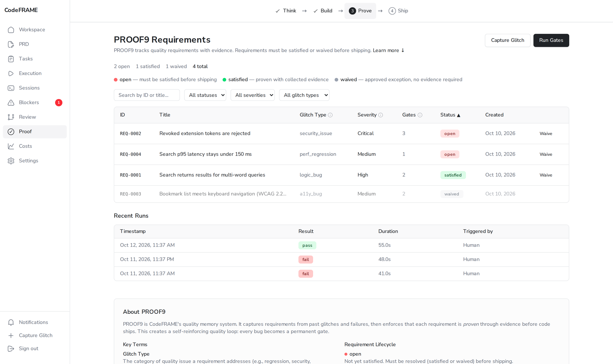
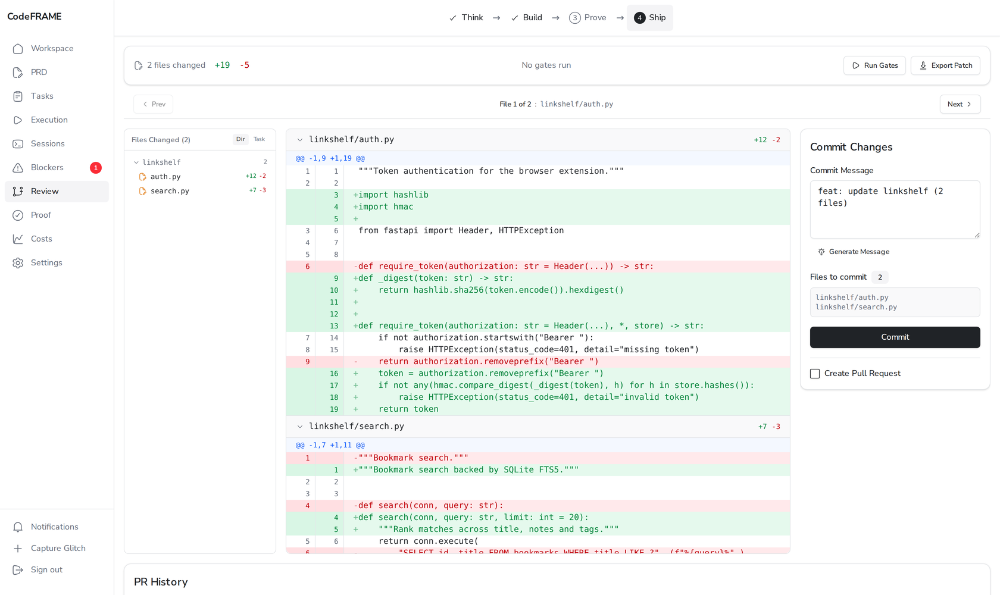
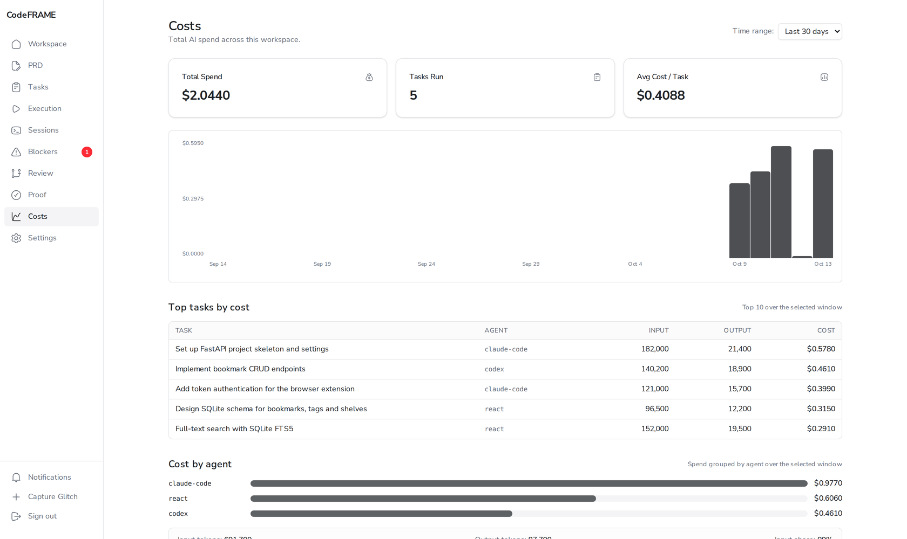

<h1 align="center">CodeFRAME™</h1>

<p align="center">
  <strong>A project delivery system for AI-written software.</strong><br>
  CodeFRAME owns everything before and after the code: requirements, task planning, verification and release.<br>
  The coding itself goes to the agent of your choice.
</p>

<p align="center">
  
  <a href="https://pypi.org/project/codeframe-ai/"></a>
  
  
  <a href="https://github.com/frankbria/codeframe/actions/workflows/test.yml"></a>
  
  <a href="https://x.com/FrankBria18044"></a>
</p>

<p align="center">
  <a href="#quick-start">Quick start</a> ·
  <a href="#see-it-in-action">Demos</a> ·
  <a href="docs/CLI_GUIDE.md">CLI guide</a> ·
  <a href="docs/WEB_UI_GUIDE.md">Web UI guide</a> ·
  <a href="#documentation">Docs</a> ·
  <a href="CHANGELOG.md">Changelog</a>
</p>

---

## Overview

Coding agents have become very good at writing code, but writing code is not
the same as shipping software. Before the code, someone decides what to build,
breaks it into tasks an agent can finish, and resolves the ambiguities. After
it, someone checks that it works, makes sure old bugs stay fixed, and merges
with confidence. Today that someone is still you.

CodeFRAME automates those two edges. It turns an idea into a PRD and a
dependency-ordered task graph, delegates each task to **Claude Code, Codex,
OpenCode, Kilocode** or its built-in ReAct agent, verifies the result against
an evidence-based quality ledger, and refuses to merge while a known problem is
still open.

| Stage | What CodeFRAME does | Commands |
|---|---|---|
| **Think** | Socratic requirements discovery, ambiguity stress-testing, task decomposition with dependencies | `cf prd generate` · `cf prd stress-test` · `cf tasks generate` |
| **Build** | Runs each task on the engine you choose, with verification gates, self-correction, stall detection and human-in-the-loop blockers | `cf work start --engine …` · `cf work batch run` |
| **Prove** | **PROOF9**: every glitch becomes a permanent requirement, verified across nine gates with checksummed evidence | `cf proof capture` · `cf proof run` |
| **Ship** | Pull requests carry the proof report; merge is blocked while an in-scope requirement is open | `cf pr create` · `cf pr merge` |

The result is a closed loop: a bug found in production becomes a requirement,
and that requirement is checked on every build that follows.

Other tools remember what your reviewers prefer. CodeFRAME remembers what
actually broke, and proves it stays fixed: evidence is checksummed and bound to
the run and gate that produced it, a run that verified nothing is reported as
vacuous rather than green, and every waiver records who approved it, why, and
(when set) when it expires. Where each of those lives in the code is listed in
[VISION.md](docs/VISION.md#prove-is-the-output-any-good).

> [!NOTE]
> **CodeFRAME is in public beta (`0.9.5`).** The Golden Path CLI
> (`cf init/prd/tasks/work/proof/pr`) and the v2 API are stable enough to build
> on. The web UI and anything marked in progress in the
> [roadmap](docs/PRODUCT_ROADMAP.md) are still moving, and on-disk `.codeframe/`
> formats may change between betas.
> [Report rough edges](https://github.com/frankbria/codeframe/issues/new/choose).

---

## See it in action

### Command line

The CLI is the primary interface and needs no server. Below, a real session
initializes a workspace, imports a PRD, generates 18 dependency-ordered tasks
with one LLM call, and captures a bug as a PROOF9 requirement.

<p align="center">
  
</p>
<p align="center"><sub>Sped up; the LLM wait is trimmed. Full walkthrough and command reference: <a href="docs/CLI_GUIDE.md">CLI guide</a>.</sub></p>

### Web UI

The optional web UI puts the same workspace in the browser. The tour covers the
overview, the PRD, the task board, PROOF9 requirements and their evidence, the
review diff, and costs.

<p align="center">
  
</p>

<table>
  <tr>
    <td width="50%"><a href="docs/WEB_UI_GUIDE.md#build-task-board-execution-blockers"></a><p align="center"><sub><b>Task board</b>: Kanban, dependencies, batch runs, per-task cost</sub></p></td>
    <td width="50%"><a href="docs/WEB_UI_GUIDE.md#prove-proof9-requirements-and-evidence"></a><p align="center"><sub><b>PROOF9</b>: requirements, gate runs, waivers with audit trail</sub></p></td>
  </tr>
  <tr>
    <td width="50%"><a href="docs/WEB_UI_GUIDE.md#ship-review-commit-and-pull-requests"></a><p align="center"><sub><b>Review</b>: diff, gates, commit and pull request</sub></p></td>
    <td width="50%"><a href="docs/WEB_UI_GUIDE.md#costs"></a><p align="center"><sub><b>Costs</b>: spend by day, task and agent</sub></p></td>
  </tr>
</table>

<p align="center"><sub>Every page, explained: <a href="docs/WEB_UI_GUIDE.md">Web UI guide</a>.</sub></p>

---

## Quick Start

**Prerequisites:** Python 3.11+, git, and an API key for your LLM provider. By
default that is `ANTHROPIC_API_KEY` from
[console.anthropic.com](https://console.anthropic.com/). `OPENAI_API_KEY` works
with `--llm-provider openai`, and local providers such as Ollama need no key.

**1. Install**

```bash
uv tool install codeframe-ai     # installs the `cf` command
cf --help
```

`pipx install codeframe-ai` works too, or run it without installing via
`uvx codeframe-ai --help`. The package is `codeframe-ai`; the command is `cf`.

**2. Set your API key**

```bash
export ANTHROPIC_API_KEY="sk-ant-..."
# or store it once: cf auth setup --provider anthropic
```

**3. Think: requirements and tasks**

```bash
cd /path/to/your/project
cf init . --detect       # create the workspace, detect the tech stack
cf prd generate          # Socratic discovery (or: cf prd add PRD.md)
cf tasks generate        # dependency-ordered tasks, created in BACKLOG
cf tasks list
```

**4. Build: run one task**

```bash
cf tasks set status <task-id> READY
cf work start <task-id> --execute                       # built-in agent
cf work start <task-id> --execute --engine claude-code  # or codex, opencode, kilocode
```

If the agent needs a decision it cannot make, it stops and files a blocker.
`cf blocker list` shows it and `cf blocker answer <id> "..."` unblocks the task.

**5. Prove: capture a requirement, then verify it**

```bash
cf proof capture --title "add() is wrong for negatives" \
  --description "add(-1, -1) returned 0" --where src/calc.py --severity high --source qa
# turn the generated tests/proof/REQ-0001/draft_*.py stubs into real tests, then:
cf proof run --full
```

`cf proof capture` also works on its own in any git repository. It creates
`.codeframe/` on first use, so you can start recording defects without `cf init`.

**6. Ship**

```bash
export GITHUB_TOKEN=... GITHUB_REPO=owner/repo   # or connect in Settings → Integrations
cf pr create
cf pr merge <number>     # refused while an in-scope requirement is open
```

An empty directory through a green `cf proof run` takes **about 6 minutes** on
a clean machine: [measured, step by step](docs/demos/quickstart-cleanroom.md).
The [CLI guide](docs/CLI_GUIDE.md#walkthrough) explains each step in depth,
including batch runs over a whole backlog.

<details>
<summary>Install from source (contributors)</summary>

```bash
git clone https://github.com/frankbria/codeframe.git && cd codeframe
curl -LsSf https://astral.sh/uv/install.sh | sh
uv venv && source .venv/bin/activate && uv sync
uv run cf --help
```

To run the web UI from the checkout, follow
[Running the web UI](docs/WEB_UI_GUIDE.md#running-the-web-ui).
</details>

---

## Features

### Think
- **Socratic PRD discovery** that stops on its own: at most 10 questions by
  default, an early stop once coverage plateaus, a duplicate-question guard, and
  `/done` to finish on demand. Uncovered areas become open questions in the PRD.
- **Stress testing** extracts every goal, analyzes it, and returns
  severity-tagged ambiguities that you answer to refine the PRD.
- **Task decomposition** into atomic tasks with a dependency graph, 5 PRD
  templates, 7 task templates, and CPM-based schedule prediction.
- **GitHub Issues import**: turn a repository's open issues into tasks that
  link back and close the issue when done.

### Build
- **Agent-agnostic execution**: Claude Code, Codex, OpenCode, Kilocode, or the
  built-in ReAct agent, selected per run with `--engine`.
- **Verification gates** (ruff, pytest, build) with a self-correction loop and
  loop prevention.
- **Stall detection** with configurable recovery: retry, raise a blocker, or fail.
- **Batch execution**: serial, parallel, or auto (LLM-inferred dependencies),
  with retries and git worktree isolation for parallel agents.
- **Human-in-the-loop blockers**, checkpoints, replay of past runs, and a TUI
  dashboard.
- **Multi-provider LLM**: Anthropic by default, or any OpenAI-compatible
  endpoint (OpenAI, Ollama, vLLM, LM Studio).

### Prove
- **PROOF9 quality memory**: nine gates (unit, contract, e2e, visual, a11y,
  perf, sec, demo, manual). A captured glitch gets its obligations and draft
  test stubs generated automatically.
- **Evidence you can trust**: artifacts are checksummed and bound to the run
  and gate that produced them. A run that verified nothing is reported as
  vacuous, never as a pass.
- **Every gate has a real check**: `UNIT` and `CONTRACT` run pytest and `SEC`
  runs bandit. `E2E`, `VISUAL`, `A11Y`, `PERF` and `DEMO` are enforced through
  their evidence rules: each obligation gets a `test_a11y_*` / `test_perf_*` /
  … test that runs by name, and a missing test is a failure. `MANUAL` is
  resolved only by a justified waiver.
- **Scoped runs**: `cf proof run` checks only the requirements your diff
  touches, and `--full` checks every requirement except waived ones.
- **Waivers** require a reason, record who approved them, can expire, and stay in the
  audit trail.

### Ship
- **Pull requests with a proof report** attached to the body.
- **Merge gate** enforced server-side and in `cf pr merge`, scoped to the
  PR's changed files (renames included). An override requires a reason and is
  recorded in an audit ledger.
- **Cost tracking** per task, per agent and per day, plus an optional per-user
  daily spend limit on the server.

### Platform
- **CLI-first**: the whole pipeline runs from the terminal with no server.
  SQLite storage, no daemons.
- **Optional server and web UI**: FastAPI v2 API (OpenAPI docs, API keys,
  scoped JWT auth, rate limiting, SSE and WebSocket streams) and a Next.js
  dashboard with interactive agent sessions and an in-browser terminal.
- **Notifications**: in-app and browser notifications, plus an outbound webhook
  for batch completions, blockers and merges.

---

## Architecture

```
            ┌──────────────── cf CLI ────────────────┐     ┌──── Web UI (Next.js) ────┐
            │  direct calls, no server required      │     │  REST · SSE · WebSocket  │
            └───────────────────┬────────────────────┘     └────────────┬─────────────┘
                                │                                       │
                                │                      ┌────────────────▼─────────────┐
                                │                      │  FastAPI server (optional)   │
                                │                      │  thin adapter, auth, limits  │
                                ▼                      └────────────────┬─────────────┘
            ┌───────────────────────────────────────────────────────────▼─────────────┐
            │  codeframe/core: headless domain and orchestration                      │
            │  THINK  prd · discovery · stress test · tasks · dependency graph        │
            │  BUILD  runtime · conductor · gates · self-correction · stall detection │
            │  PROVE  PROOF9 ledger · scope · evidence                                │
            │  SHIP   GitHub PRs · merge gate                                         │
            └───────────┬──────────────────────────────┬──────────────────────────────┘
                        ▼                              ▼
         Coding engines                       LLM providers                 Storage
         Claude Code · Codex · OpenCode       Anthropic · OpenAI ·          .codeframe/state.db
         Kilocode · built-in ReAct            any OpenAI-compatible         (per workspace)
```

The core is headless and runs entirely from the CLI. The server and web UI are
optional adapters over it. See [Agent System Reference](docs/AGENT_SYSTEM_REFERENCE.md)
for the execution flows.

---

## Configuration

```bash
# Required for the default provider
export ANTHROPIC_API_KEY=sk-ant-...

# Another provider (optional)
export CODEFRAME_LLM_PROVIDER=openai             # anthropic | openai | ollama | vllm | compatible
export CODEFRAME_LLM_MODEL=gpt-4o
export OPENAI_API_KEY=sk-...                     # not needed for local providers
export OPENAI_BASE_URL=http://localhost:11434/v1 # Ollama, vLLM, LM Studio, ...
```

Per-workspace settings live in `.codeframe/config.yaml` (an `llm:` block, and
`discovery_max_questions`). For the LLM provider and model, precedence is CLI
flag, then environment, then workspace config, then default.

Running the server needs `AUTH_SECRET` and `WORKSPACE_ROOT`; see the
[Quickstart](docs/QUICKSTART.md) and the [deployment guide](deploy/README.md)
for every server, auth and rate-limit option.

### Privacy and telemetry

Telemetry is **opt-in** and off by default. When enabled it sends the command
name, duration, exit code, version and OS, never code, prompts, arguments or
file paths. Control it with `cf config telemetry on|off|status`,
`CODEFRAME_TELEMETRY=on|off`, or `DO_NOT_TRACK=1`. See [PRIVACY.md](PRIVACY.md).

---

## Documentation

| Guide | What's in it |
|---|---|
| [CLI guide](docs/CLI_GUIDE.md) | Walkthrough plus the complete command reference |
| [Web UI guide](docs/WEB_UI_GUIDE.md) | Running the dashboard, page by page with screenshots |
| [Quickstart](docs/QUICKSTART.md) | Install, keys, server variables, first run |
| [Cold start on a clean machine](docs/demos/quickstart-cleanroom.md) | A measured, narrated run of the Golden Path |
| [Golden Path](docs/GOLDEN_PATH.md) | The CLI-first workflow contract |
| [Product roadmap](docs/PRODUCT_ROADMAP.md) | Phase plan and feature status |
| [Vision](docs/VISION.md) | The Think → Build → Prove → Ship thesis |
| [Agent system reference](docs/AGENT_SYSTEM_REFERENCE.md) | Agent components, model selection, execution flows |
| [ReAct agent architecture](docs/REACT_AGENT_ARCHITECTURE.md) | Tools, editor, token management |
| [Server developer guide](docs/PHASE_2_DEVELOPER_GUIDE.md) | v2 router patterns and the API layer |
| [Web UI architecture](docs/PHASE_3_UI_ARCHITECTURE.md) | Pages, components, data flow |
| [Deployment](deploy/README.md) | Container deployment behind Caddy |

---

## Roadmap

Think, Build, Prove and Ship all work end to end from the CLI and the browser.
The [product roadmap](docs/PRODUCT_ROADMAP.md) is the authority on phase status.

**Next up**

- [ ] Post-merge glitch capture loop
- [ ] Engine performance tracking and automatic routing
- [ ] Specification-level dependency analysis

<details>
<summary><b>Shipped</b></summary>

**Think**
- [x] `cf prd stress-test`: recursive decomposition that surfaces ambiguities before execution
- [x] Multi-round PRD refinement with domain-specific probes

**Build**
- [x] Agent adapter architecture: delegate to Claude Code, Codex, OpenCode, Kilocode
- [x] Worktree isolation for parallel agent execution
- [x] Reconciliation layer for multi-agent output
- [x] Replay/debug mode (`cf work replay`, built-in ReAct engine)
- [x] TUI dashboard (`cf dashboard`)
- [x] Dynamic config reload during batch execution
- [x] Multi-provider LLM: Anthropic, OpenAI, or any OpenAI-compatible endpoint

**Prove**
- [x] PROOF9: 9-gate evidence-based quality system
- [x] `cf proof capture`: the glitch-to-requirement closed loop
- [x] Run gates from the web UI: live progress, per-gate evidence, run history
- [x] Glitch capture web UI: `CaptureGlitchModal` plus the REQ detail view at `/proof/[req_id]`
- [x] Merge gating on PROOF9 pass: enforced server-side at the merge API, with an audited override (actor + reason)

**Ship**
- [x] PR status tracking + CI check display in the web UI (`PRStatusPanel` on `/review`)

**Web UI**
- [x] Workspace and PRD views with Socratic discovery, version history, diff/restore
- [x] Task board with Kanban, dependency badges, traceability badges, batch execution
- [x] Blocker resolution, review and commit with diff viewer
- [x] Interactive Agent Sessions: chat panel (tool calls, thinking blocks), XTerm.js terminal
- [x] Run gates button, live gate progress, per-gate evidence display, run history panel
- [x] Glitch capture form and REQ detail view (scope metadata, obligations, sortable evidence history)
- [x] PR status panel with PROOF9-gated merge button (gate also enforced server-side)

</details>

---

## Contributing

```bash
uv sync --extra dev && pre-commit install
uv run pytest tests/ --ignore=tests/e2e -m "not lifecycle"   # the CI gate
uv run ruff check .
cd web-ui && npm ci && npm test && npm run build              # web UI
```

The suite has 5,000+ tests, and contributions need 80% test coverage, the floor CI enforces. Code
standards are ruff, type hints and tests with every change. During the beta,
feature ideas go to [Discussions → Ideas](https://github.com/frankbria/codeframe/discussions/categories/ideas)
before code. See [CONTRIBUTING.md](CONTRIBUTING.md) for what is stable and how
to propose changes.

---

## Security, licensing and support

- **Security:** report vulnerabilities privately through
  [GitHub private vulnerability reporting](https://github.com/frankbria/codeframe/security/advisories/new)
  or `security@codeframe.sh`, never in a public issue. See [SECURITY.md](SECURITY.md).
- **Licensing:** CodeFRAME is [Apache-2.0](LICENSE).
  [LICENSING.md](LICENSING.md) explains what that allows and the few things it
  asks of you. A hosted offering and commercial support are planned:
  `licensing@codeframe.sh`.
- **Trademark:** the CodeFRAME name and logo are trademarks and are *not*
  covered by the code license. See [TRADEMARKS.md](TRADEMARKS.md) before using
  the name for a fork or product.
- **Design partners:** we are recruiting 5–10 teams for the beta cohort. See
  [DESIGN_PARTNERS.md](DESIGN_PARTNERS.md), then email `hello@codeframe.sh` or
  reply to the pinned [Discussion](https://github.com/frankbria/codeframe/discussions).
- **Help:** [Q&A](https://github.com/frankbria/codeframe/discussions/categories/q-a)
  for questions, [Ideas](https://github.com/frankbria/codeframe/discussions/categories/ideas)
  for feature requests, and [issues](https://github.com/frankbria/codeframe/issues/new/choose)
  for confirmed bugs.

---

## License

[Apache-2.0](LICENSE): free to use, modify and distribute, including in
commercial and closed-source products. Keep the license and [NOTICE](NOTICE)
file with any copy you distribute, and mark the files you change. See
[LICENSING.md](LICENSING.md) for a plain-language explanation.

The **CodeFRAME™ name and logo are trademarks** of Noatak Enterprises, LLC,
dba Bria Strategy Group, and are not licensed under Apache-2.0. See
[TRADEMARKS.md](TRADEMARKS.md).

---

<p align="center">
  <b>Built by <a href="https://x.com/FrankBria18044">Frank Bria</a></b><br>
  <a href="https://github.com/frankbria/codeframe/issues">Issues</a> ·
  <a href="https://github.com/frankbria/codeframe/discussions">Discussions</a> ·
  <a href="https://github.com/frankbria/codeframe/tree/main/docs">Documentation</a>
</p>

<p align="center"><sub>CodeFRAME™ is a trademark of Noatak Enterprises, LLC, dba Bria Strategy Group. All rights reserved.</sub></p>
