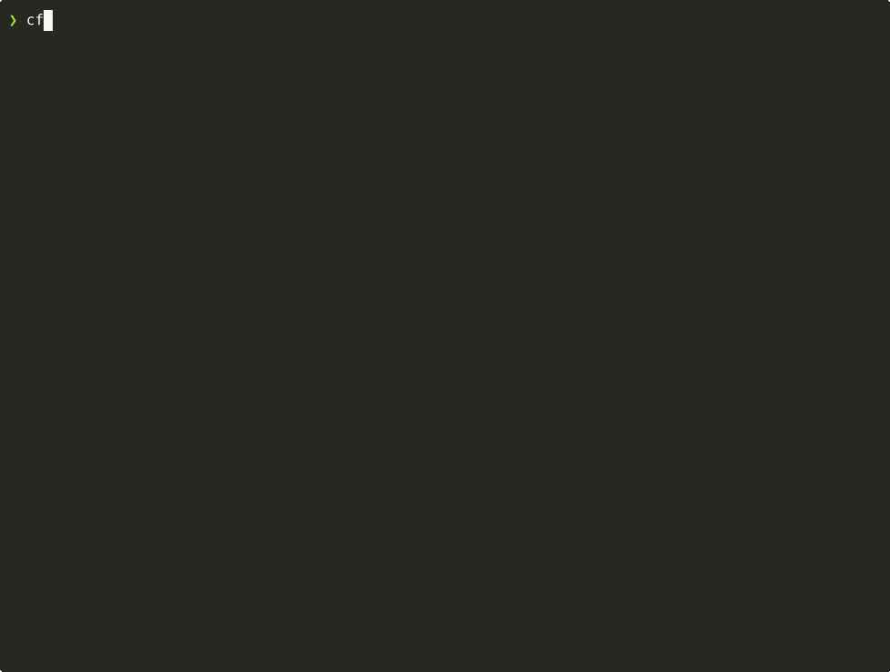

# CodeFRAME CLI Guide

The `cf` command is the primary interface to CodeFRAME. Every stage of the
pipeline (Think, Build, Prove, Ship) runs from the terminal with **no server
running**; the [web UI](WEB_UI_GUIDE.md) is an optional layer on the same core.

<p align="center">
  
</p>
<p align="center"><sub>A real session against a sample FastAPI project. Playback is sped up and the LLM wait is trimmed.</sub></p>

**Contents**

- [Walkthrough](#walkthrough)
- [Think: requirements and planning](#think-requirements-and-planning)
- [Build: execution](#build-execution)
- [Prove: verification](#prove-verification)
- [Ship: delivery](#ship-delivery)
- [Choosing a model or provider](#choosing-a-model-or-provider)

> If you installed from source, prefix every command with `uv run` (for example
> `uv run cf init .`), or activate the virtual environment first.

---

## Walkthrough

This is the loop the GIF above records, extended through Build, Prove and Ship.

### 1. Initialize a workspace

```bash
cf init . --detect
```

`--detect` reads your project files to record the tech stack. Workspace state
lives in `.codeframe/` inside the repository and is git-ignored automatically.

### 2. Think: write the PRD and decompose it

```bash
cf prd generate          # AI-guided Socratic discovery
# or, if you already have one:
cf prd add PRD.md
cf tasks generate        # atomic tasks with a dependency graph
cf tasks list
```

Discovery asks at most 10 questions by default (`--max-questions` changes the
cap) and stops early once answers stop adding coverage. Type `/done` to finish
on the spot, or `/pause` to save and resume later with `cf prd generate --resume <id>` (the ID `/pause` prints).
Anything still uncovered is written into the PRD as open questions.

`cf tasks generate` creates every task in `BACKLOG`, so nothing touches your code
until you choose to proceed.

### 3. Build: hand a task to an agent

```bash
cf tasks set status <task-id> READY      # the 8-character ID from cf tasks list
cf work start <task-id> --execute        # built-in ReAct agent
cf work start <task-id> --execute --engine claude-code   # or codex, opencode, kilocode
```

CodeFRAME runs the verification gates (ruff, pytest, build) after the agent
finishes and feeds failures back into a self-correction loop. If the agent needs
a decision it cannot make, it files a **blocker** instead of guessing:

```bash
cf blocker list
cf blocker answer <blocker-id> "Use PostgreSQL"
cf work resume <task-id>
```

### 4. Prove: capture a requirement and verify it

PROOF9 verifies *obligations*, and a new workspace has none. A run that checked
nothing is reported as such (exit code `2`), never as a pass. Capture something
to check:

```bash
cf proof capture \
  --title "add() returns the wrong sum for negative numbers" \
  --description "add(-1, -1) returned 0 instead of -2" \
  --where src/calc.py --severity high --source qa
```

CodeFRAME classifies the glitch, picks the gates that would have caught it, and
writes a **draft** test stub per gate under `tests/proof/<REQ-ID>/`. The stubs
are named `draft_*.py` so pytest does not collect them, and each one is a
placeholder `assert False`. Rename each to `test_*.py` and replace the
placeholder with an assertion that proves the bug is fixed. Then:

```bash
cf proof run --full      # every requirement except waived ones
cf proof run             # only the requirements your current diff touches
```

The `unit` and `contract` gates run **your project's** pytest, so the project
needs pytest available (`uv add --dev pytest`). A gate with no way to run is
reported as unverified, never as a pass.

### 5. Ship: open and merge a pull request

`cf pr` talks to GitHub. Connect a repository in the web UI (Settings →
Integrations), or export `GITHUB_TOKEN` (a PAT with `repo` scope) and
`GITHUB_REPO=owner/repo`.

```bash
cf pr create             # PR body ends with the workspace's PROOF9 status
cf pr merge <number>     # refused while a requirement in the PR's scope is open
```

`cf pr merge --override --reason "..."` bypasses the gate and records who did
it and why in an audit ledger.

For a measured, end-to-end run of these steps on a clean machine, see
[Cold start on a clean machine](demos/quickstart-cleanroom.md).

---

## Think: requirements and planning

```bash
# Workspace
cf init <path>                        # Initialize workspace
cf init <path> --detect               # Auto-detect tech stack
cf status                             # Workspace status

# Requirements
cf prd generate                       # AI-guided Socratic PRD creation
cf prd generate --template lean       # Use a specific template
cf prd generate --max-questions 6     # Cap discovery (default 10; /done finishes early)
cf prd add <file.md>                  # Import an existing PRD
cf prd show                           # Display the current PRD
cf prd stress-test                    # Surface ambiguities before execution

# Task decomposition
cf tasks generate                     # Generate tasks from the PRD (LLM-powered)
cf tasks list                         # List all tasks
cf tasks list --status READY          # Filter by status
cf tasks show <id>                    # Task details with dependencies
cf tasks set status <id> READY        # Promote one task
cf tasks set status READY --all --from BACKLOG   # Promote the whole backlog

# Scheduling
cf schedule show                      # Task schedule with dependencies
cf schedule predict                   # Completion date estimates
cf schedule bottlenecks               # Identify blocking tasks

# Migration / on-ramps
cf import ralph [path]                # Import a ralph-claude-code project
cf import ralph [path] --dry-run      # Preview the mapping without changes
cf import ralph [path] -w <workspace> # Import into a specific workspace
```

## Build: execution

```bash
# Single task
cf work start <id> --execute                       # Default engine (ReAct)
cf work start <id> --execute --engine claude-code  # Delegate to Claude Code
cf work start <id> --execute --engine codex        # ... or Codex, OpenCode, Kilocode
cf work start <id> --execute --verbose             # Detailed progress output
cf work start <id> --execute --dry-run             # Preview without applying
cf work start <id> --execute --stall-timeout 120   # Custom stall timeout (seconds)
cf work start <id> --execute --stall-action retry  # On stall: blocker | retry | fail
cf work follow <id>                   # Stream live output
cf work stop <id>                     # Cancel a run
cf work resume <id>                   # Resume after answering blockers

# Batch execution
cf work batch run --all-ready                # All READY tasks
cf work batch run --strategy parallel --max-parallel 4
cf work batch run --strategy auto            # LLM-inferred dependencies
cf work batch run --retry 3                  # Auto-retry failures
cf work batch status [batch_id]              # Recent batches, or one batch
cf work batch follow <batch_id>              # Live progress
cf work batch resume <batch_id>              # Re-run failed tasks

# Blockers (human-in-the-loop)
cf blocker list                       # Questions the agent needs answered
cf blocker show <id>                  # Blocker details
cf blocker answer <id> "answer"       # Unblock the agent

# Diagnostics
cf work diagnose <id>                 # Pattern-based failure analysis
cf work replay <run-id>               # Replay a past run (built-in ReAct engine)
cf env check                          # Validate the environment
cf env doctor                         # Comprehensive health check
cf dashboard                          # TUI dashboard
```

Batch runs are long-running: each task is a full agent run and serial is the
default strategy. Start the batch, then watch it from another terminal with
`cf work batch follow`.

## Prove: verification

```bash
cf proof capture                      # Capture a glitch as a permanent requirement
cf proof ratchet [--dry-run]          # Lock every currently-passing test in as a requirement
cf proof run                          # Run obligations touched by the current diff
cf proof run --full                   # Re-check every non-waived requirement
cf proof list                         # List all requirements
cf proof status                       # Summary across all gates
cf proof show <id>                    # Requirement detail and evidence
cf proof waive <id> --reason "..."    # Waive with a justification
cf proof export --format pdf          # Evidence report: html (default), json or pdf

cf review                             # Run verification gates on the working tree
cf checkpoint create "milestone"      # Snapshot task state
cf checkpoint list
cf checkpoint restore <id>            # Restore task statuses (files untouched)
```

`cf proof capture` works in any git repository, with or without `cf init`: it
creates `.codeframe/` at the repository's top level the first time it runs.
`cf proof ratchet` creates it the same way. Every other `cf proof` command needs
a workspace that already exists.

**Ratchet: start from the tests you already have.** A fresh ledger is empty, so
`cf proof run` has nothing to enforce. `cf proof ratchet` runs your pytest suite
once and turns each passing test into a requirement with one `UNIT` obligation
naming that test, so nothing that passes today can silently stop passing. Each
one is scoped to the files its test covers when the project has `pytest-cov`,
and to the whole repository otherwise. Failing and skipped tests are not locked
in, and re-running adds only tests not already locked. `--dry-run` shows what it
would lock; `--path 'tests/unit/*'` narrows it. It exits 2 when there is nothing
to lock (no tests, or none pass) and 1 when the suite cannot run. Run
`cf proof run --full` afterwards to record their evidence; until then the merge
gate treats them as open. Once satisfied, a plain `cf proof run` re-checks each
one whenever your uncommitted changes touch its scope, and `--full` re-checks
them all. A regression that is already committed is caught by `--full`, or by
the next change that touches it.

**Machine-readable output.** `run`, `list`, `status`, `show`, `capture` and
`ratchet` take `--json`: stdout then holds one JSON document, and progress,
warnings, errors and prompts go to stderr. Exit codes are the same as without
it, and a command that fails before it has a result prints nothing on stdout.
A run reports `passed` (obligations ran and none failed), `failed` (one
failed) and, when nothing ran, `empty_reason`; `vacuous` marks a pass that
verified nothing. `status` counts `failing` (not waived, with a failed
obligation) and `locked` (from the ratchet).

**How each gate is verified.** `UNIT` and `CONTRACT` run pytest, and `SEC` runs
bandit. `E2E`, `VISUAL`, `A11Y`, `PERF` and `DEMO` have no dedicated runner and
are enforced through their evidence rules: `cf proof capture` generates a
`test_<gate>_*` stub per obligation, and once implemented that test is run by
name. A named test that does not exist is a failure, not a pass.

`MANUAL` is never machine-verified. A MANUAL obligation reports `unverifiable`
and is resolved by waiving it with a justification.

Evidence artifacts are checksummed and bound to the run and gate that produced
them, so an edited or transplanted artifact is reported as tampered rather than
counted as proof.

## Ship: delivery

```bash
cf pr create --title "Add search"     # PR from the current branch, PROOF9 report appended
cf pr list                            # List open PRs
cf pr status                          # Open PR for the current branch
cf pr get <number>                    # Details for one PR
cf pr merge <number>                  # Merge (refused while an in-scope requirement is open)
cf pr close <number>                  # Close without merging
cf commit create -m "feat: search"    # Commit verified changes
cf patch export                       # Export changes as a patch
```

## Choosing a model or provider

Anthropic is the default. Any OpenAI-compatible endpoint works too:

```bash
cf work start <id> --execute --llm-provider openai --llm-model gpt-4o
OPENAI_BASE_URL=http://localhost:11434/v1 \
  cf work start <id> --execute --llm-provider ollama --llm-model qwen2.5-coder:7b
```

The same choice can be made with `CODEFRAME_LLM_PROVIDER` / `CODEFRAME_LLM_MODEL`
or per workspace in `.codeframe/config.yaml`. See
[Configuration](../README.md#configuration) for the full list.
