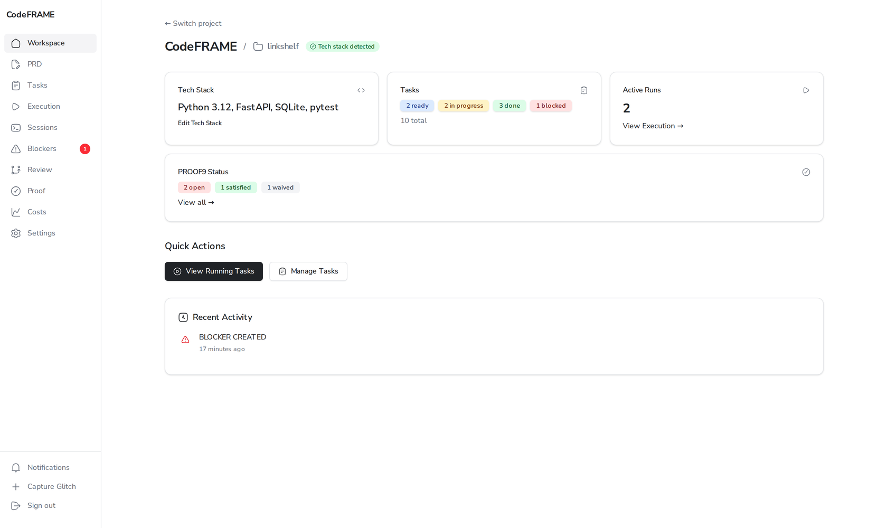
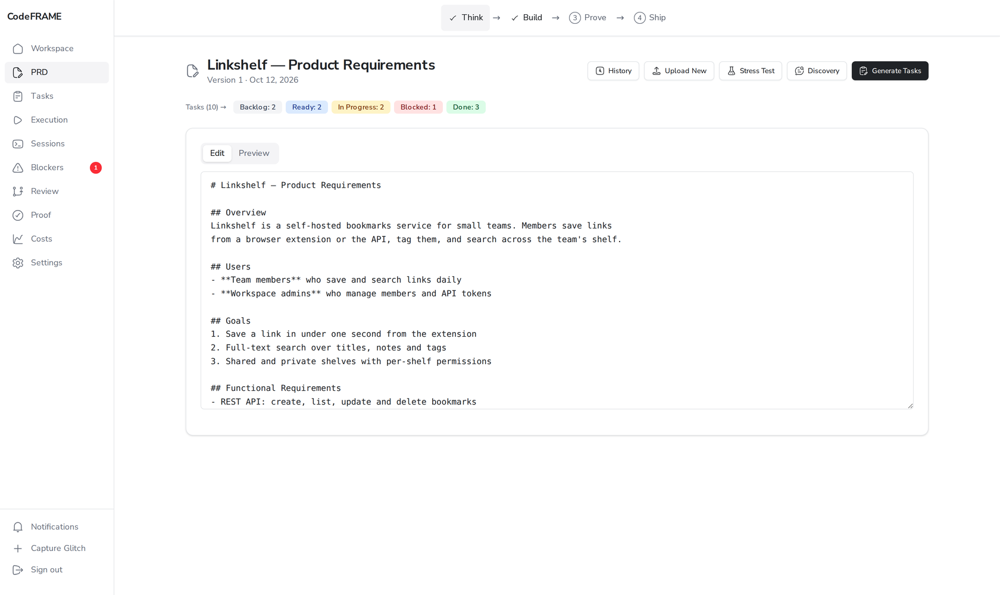
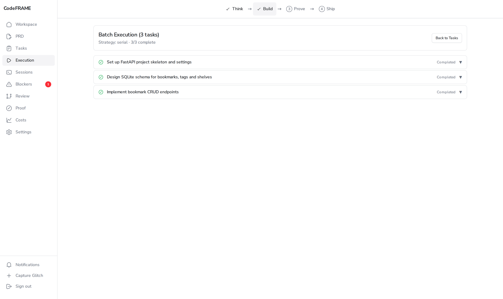
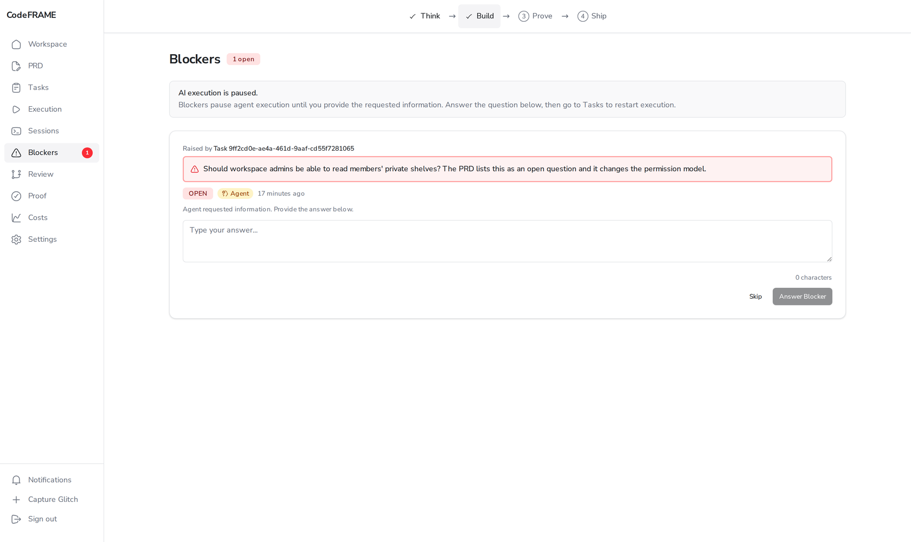
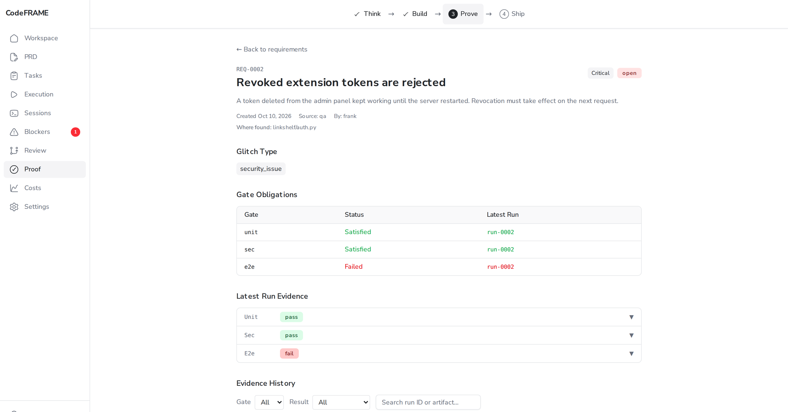

# CodeFRAME Web UI Guide

The web UI is a Next.js dashboard over the same headless core the CLI uses.
Everything you do in one shows up in the other: a task generated with
`cf tasks generate` appears on the board, and a requirement captured in the
browser is enforced by `cf pr merge`.

<p align="center">
  
</p>

**Contents**

- [Running the web UI](#running-the-web-ui)
- [Workspace overview](#workspace-overview)
- [Think: PRD and discovery](#think-prd-and-discovery)
- [Build: task board, execution, blockers](#build-task-board-execution-blockers)
- [Prove: PROOF9 requirements and evidence](#prove-proof9-requirements-and-evidence)
- [Ship: review, commit and pull requests](#ship-review-commit-and-pull-requests)
- [Costs](#costs)
- [Sessions and settings](#sessions-and-settings)

> The screenshots show a sample project, *Linkshelf*, a FastAPI bookmarks
> service mid-way through its build.

---

## Running the web UI

The UI is a separate Next.js app that talks to `codeframe serve`. Start the API
server in one terminal (it binds `127.0.0.1:8080`):

```bash
export AUTH_SECRET=$(openssl rand -hex 32) WORKSPACE_ROOT=$HOME/projects
codeframe serve
```

Start the UI in a second terminal from a source checkout, then open
<http://localhost:3000>:

```bash
cd web-ui
npm ci
npm run dev
```

Create the first account on the same machine and sign in at `/login`:

```bash
codeframe auth register --email you@example.com
```

Authentication is on by default, and the server refuses to start without
`AUTH_SECRET` and `WORKSPACE_ROOT`. The [Quickstart](QUICKSTART.md#run-the-web-ui-locally)
covers every variable; [`deploy/README.md`](../deploy/README.md) covers the
container deployment behind Caddy.

---

## Workspace overview



The landing page summarizes one workspace: the detected tech stack, tasks by
status, active agent runs, and open versus satisfied PROOF9 requirements. The
sidebar badge counts open blockers, so a stalled agent is visible from any page.
**Capture Glitch** in the sidebar footer opens the requirement form from
anywhere.

## Think: PRD and discovery



The PRD page holds the current requirements document with full version history,
diff and restore. From here you can:

- **Discovery**: run the same Socratic Q&A as `cf prd generate`, with a coverage
  indicator, a resume prompt for paused sessions and a **Finish now** button.
- **Stress Test**: stream an analysis of every goal and get severity-tagged
  ambiguities back. Answer them and **Refine PRD** folds the answers into a new
  version.
- **Generate Tasks**: decompose the PRD into tasks with dependencies.

## Build: task board, execution, blockers


The task board is a Kanban view of every task, with search, status filters,
dependency badges, and per-card cost badges once an agent has run. Promote,
execute or stop tasks individually, or select several and run them as a
**Batch** (serial, parallel or auto). **Import from GitHub** turns open issues
from a connected repository into tasks, linked back to the issue and optionally
closed when the task is done.



The execution view streams a running task's events live and tracks batches
task by task.



When an agent hits a decision it should not make alone, it pauses and files a
blocker. Answer it here and restart the task.

## Prove: PROOF9 requirements and evidence


PROOF9 is CodeFRAME's quality memory. Every captured glitch becomes a
requirement with obligations across nine gates (unit, contract, e2e, visual,
a11y, perf, sec, demo, manual). The page lists them with filters, runs the
gates with live progress, and keeps the run history.



Each requirement's page shows its scope, the status of every obligation, and the
evidence from each run. Evidence is checksummed and bound to the run that
produced it, so edited artifacts are flagged rather than trusted. A requirement
can be waived only with a reason and an optional expiry; who approved it is
recorded automatically, and all of it stays in the audit trail.

## Ship: review, commit and pull requests


The review page shows the working-tree diff file by file, runs the
verification gates, and commits with a generated or hand-written message. It
can open a pull request in the same step. The PR status panel shows review
state and CI checks; **Merge** goes through the server-side PROOF9 gate, which
refuses while an in-scope requirement is open unless an admin records an
override with a reason.

## Costs


Token usage is recorded for every LLM call. The costs page breaks spend down by
day, by task and by agent, so you can compare engines on the same backlog.

## Sessions and settings

- **Sessions**: interactive agent sessions with a streaming chat panel (tool
  calls and thinking blocks shown inline) beside an XTerm.js terminal in the
  workspace. The terminal is available to admins only.
- **Settings**: agent limits (max turns and cost per task), API keys stored in
  your own credential store, GitHub integration, an outbound webhook for batch
  completions, blockers and merges, PROOF9 defaults, and workspace config.
- **Notifications**: a bell in the sidebar collects batch completions, new
  blockers and failed gates, and sends browser notifications when the tab is in
  the background.
